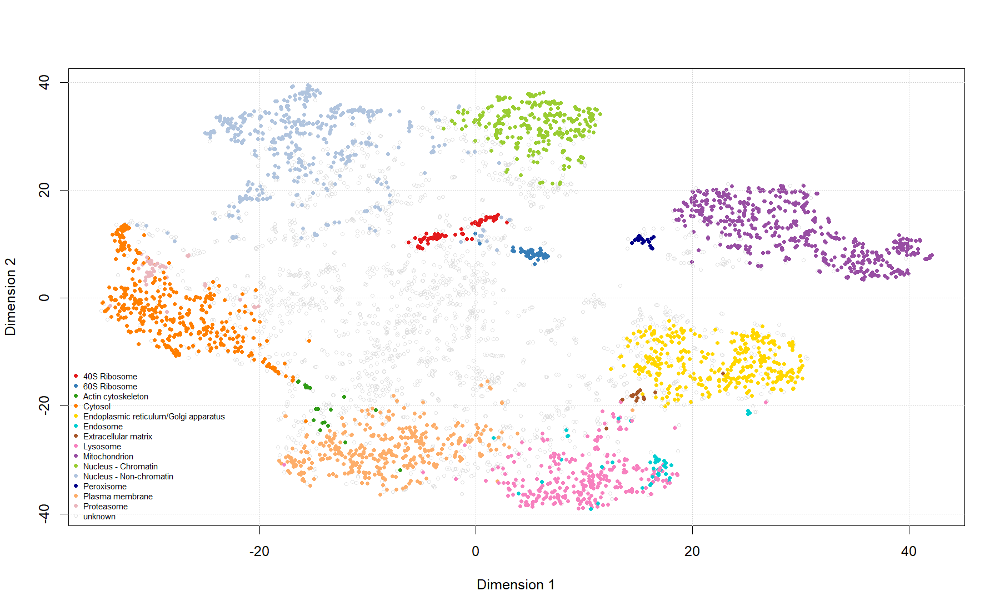
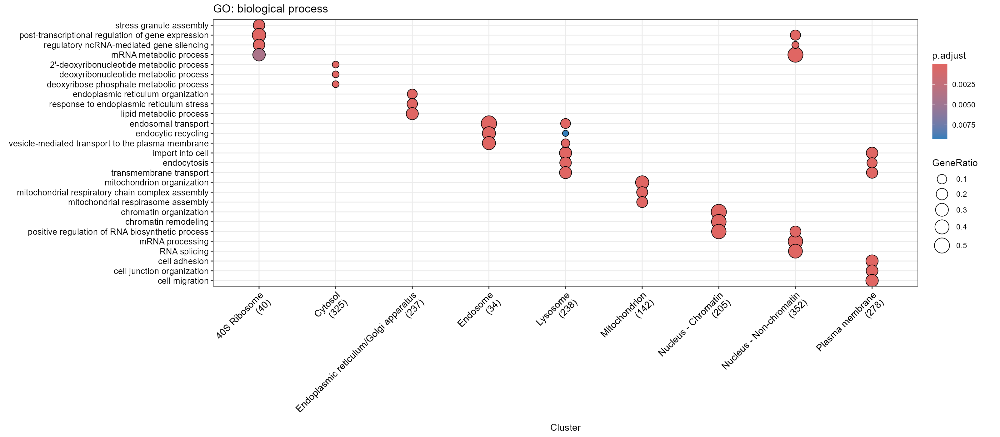

# Spatial Proteomics and Protein Subcellular Localization Prediction (hyperLOPIT2015)

A reproducible R-based spatial proteomics workflow using the `hyperLOPIT2015` dataset to explore protein abundance profiles, predict protein subcellular localization with TAGM-MAP, validate the predictions against the results stored in the dataset, and assess their biological plausibility using unsupervised HDBSCAN clustering and Gene Ontology (GO) enrichment.

<!-- Optional banner: add an image to results/figures/ and link it here -->
<!--  -->

## Research Team

**Horizon Science Communication LLC — Bioinformatics Team**

- **Shrouk Hany**
- **Dr. Hesham Abdullah**

## Project Background

Spatial proteomics investigates the subcellular localization of proteins by measuring their abundance across cellular fractions. Organelles are separated on a density gradient, each fraction is quantified by TMT mass spectrometry, and every protein therefore receives an abundance **profile** across fractions. Proteins in the same organelle tend to have similar profiles. Proteins with known localization (**markers**) can be used to train a classifier, which then predicts the localization of the remaining (**unknown**) proteins.

This project uses the published `hyperLOPIT2015` mouse embryonic stem-cell dataset, provided by the Bioconductor package `pRolocdata`, as a training and reproducibility example. The workflow follows the main analysis steps of the *Eimeria tenella* sporozoite hyperLOPIT study (Attree et al., 2026). The analysis here uses the hyperLOPIT2015 dataset, not experimental *Eimeria* data.

**Dataset:** `hyperLOPIT2015` (Bioconductor package `pRolocdata`)
**Organism:** *Mus musculus*, embryonic stem cells
**Dataset publication:** [PMID 26754106](https://pubmed.ncbi.nlm.nih.gov/26754106/)

## Project Objective

The objective is to build a documented, reproducible workflow for supervised prediction of protein subcellular localization.

The workflow is designed to:

- Inspect quantitative protein profiles and localization marker annotations.
- Visualize marker profiles and class mean profiles, and explore the data with PCA and t-SNE.
- Train a TAGM-MAP model on proteins with known localization.
- Predict localization for proteins initially labelled as unknown.
- Retain only confident predictions using a localization probability of at least 0.99.
- Compare the new predictions with the TAGM-MAP results stored in the dataset.
- Cluster proteins with HDBSCAN, without using marker labels, and compare the clusters with known markers.
- Test the confident predictions for enriched GO terms (CC, MF, BP).

## Project Overview

| Attribute | Description |
|---|---|
| Dataset | `hyperLOPIT2015` (mouse embryonic stem cells) |
| Data object | `MSnSet` (`MSnbase`) |
| Protein features | 5,032 |
| Quantitative samples | 20 (2 replicates, TMT-labelled gradient fractions) |
| Marker proteins | 926 across 13 localization classes |
| Initially unknown proteins | 4,106 |
| Classification model | TAGM-MAP (`pRoloc`) |
| Confidence threshold | Localization probability ≥ 0.99 |
| Unsupervised clustering | HDBSCAN on a t-SNE embedding (`dbscan`, `Rtsne`) |
| Functional assessment | GO enrichment (`clusterProfiler`), Benjamini–Hochberg correction |
| Language / report format | R / R Markdown (HTML report) |

The dataset is loaded directly with `data(hyperLOPIT2015)`, so no separate download of raw data is required.

## Workflow Overview

```
hyperLOPIT2015 dataset (pRolocdata)
                 |
                 v
Inspect data, markers and sample metadata
                 |
                 v
Marker abundance profiles and class mean profiles
                 |
                 v
PCA and t-SNE visualization
                 |
                 v
TAGM-MAP model training on marker proteins
                 |
                 v
Localization prediction for unknown proteins
                 |
                 v
Confidence filtering (localization probability >= 0.99)
                 |
                 v
Final assignments and visualization
                 |
                 v
Validation against stored TAGM-MAP results
                 |
                 v
Unsupervised HDBSCAN clustering (marker labels not used)
                 |
                 v
GO enrichment of confident predictions (CC, MF, BP)
```

### Confidence filtering

`localization probability = MAP allocation probability × (1 − outlier probability)`

Only proteins that were `unknown` and reach a localization probability of at least 0.99 are counted as new assignments.

## Repository Structure

```
Spatial-Proteomics-hyperLOPIT2015-TAGM-MAP/
├── README.md
├── LICENSE
├── .gitignore
│
├── analysis/
│   ├── spatial_proteomics_hyperLOPIT2015.Rmd
│   └── spatial_proteomics_hyperLOPIT2015.html
│
└── results/
    ├── figures/
    │   ├── tsne_markers.png
    │   ├── tsne_final.png
    │   ├── go_cc_dotplot.png
    │   ├── go_mf_dotplot.png
    │   └── go_bp_dotplot.png
    │
    └── tables/
        ├── GO_CC_results.csv
        ├── GO_MF_results.csv
        └── GO_BP_results.csv
```

No `data/` folder is needed because the dataset is distributed with the `pRolocdata` package. Only files that have actually been generated and checked should be committed.

## Highlights

- **Complete training workflow:** From raw marker profiles to confident localization predictions in one notebook.
- **Validated predictions:** The newly trained TAGM-MAP model reproduces the stored dataset results with 99.44% agreement.
- **Unsupervised cross-check:** HDBSCAN groups proteins without marker labels, and no marker class is split across clusters (apart from a few endosome markers).
- **Functional plausibility check:** GO terms enriched among the new assignments are consistent with the predicted organelles.
- **Transparent limits:** The report states where the methods cannot separate overlapping compartments.

## Results Showcase

### 1. Dataset and markers

| Subcellular compartment | Markers |
|:---|---:|
| 40S Ribosome | 27 |
| 60S Ribosome | 43 |
| Actin cytoskeleton | 13 |
| Cytosol | 43 |
| Endoplasmic reticulum/Golgi apparatus | 107 |
| Endosome | 13 |
| Extracellular matrix | 13 |
| Lysosome | 33 |
| Mitochondrion | 383 |
| Nucleus - Chromatin | 64 |
| Nucleus - Non-chromatin | 85 |
| Peroxisome | 17 |
| Plasma membrane | 51 |
| Proteasome | 34 |
| Unknown | 4,106 |
| **Total** | **5,032** |

The marker classes are strongly imbalanced (13 to 383 markers per class), which affects how well small classes can be modelled.

### 2. TAGM-MAP predictions

| Metric | Result |
|---|---:|
| Total proteins | 5,032 |
| Initially unknown proteins | 4,106 |
| Unknown proteins passing the 0.99 threshold | 1,983 |
| Percentage of unknown proteins passing the threshold | 48.3% |
| Unknown proteins not passing the threshold | 2,123 |

New confident assignments per compartment:

| Predicted compartment | Proteins |
|:---|---:|
| Nucleus - Non-chromatin | 364 |
| Cytosol | 332 |
| Plasma membrane | 321 |
| Lysosome | 252 |
| Endoplasmic reticulum/Golgi apparatus | 250 |
| Nucleus - Chromatin | 210 |
| Mitochondrion | 146 |
| 40S Ribosome | 43 |
| Endosome | 35 |
| Peroxisome | 9 |
| Proteasome | 9 |
| Actin cytoskeleton | 6 |
| 60S Ribosome | 4 |
| Extracellular matrix | 2 |



Proteins that did not pass the threshold may have mixed profiles, may occupy more than one compartment, or may belong to organelles without markers. They are lower-confidence results, not confirmed incorrect predictions.

### 3. Validation against the stored results

| Evaluation metric | Result |
|---|---:|
| Agreement in localization assignments across all proteins | 99.44% |
| Agreement among initially unknown proteins | 99.32% |
| Pearson correlation between stored and new MAP probabilities | 0.9982 |
| Proteins with different localization assignments | 28 |

All 28 differing proteins were initially unknown, and none of them passed the 0.99 threshold, so the final confident list is not affected by them. In most of these proteins both probabilities are very small, so the reported allocation is only the "least unlikely" class.

### 4. HDBSCAN clustering (unsupervised)

HDBSCAN was run on the t-SNE embedding (perplexity 30, seed 1) without using marker labels.

| minPts | Clusters | Noise proteins | Observation |
|---:|---:|---:|:---|
| 12 | 70 | 1,801 | Very fragmented; ribosomal subunits and proteasome split from other classes |
| 20 | 4 | 85 | Only mitochondrion and peroxisome separated |
| 30 | 6 | 580 | Clearest split (used for the analysis) |
| 50 | 5 | 700 | Similar to 30, but 16 of 17 peroxisome markers became noise |

With `minPts = 30`:

| Cluster | Size | Dominant marker content |
|---:|---:|:---|
| 1 | 622 | Mitochondrion (382 of 383) and peroxisome (17 of 17) |
| 2 | 532 | ER/Golgi (106 of 107) and extracellular matrix (13 of 13) |
| 3 | 2,369 | Large mixed cluster: ribosomes, cytosol, lysosome, plasma membrane, proteasome, actin, most endosome |
| 4 | 571 | Non-chromatin nucleus (82 of 85) |
| 5 | 304 | Chromatin nucleus (63 of 64) |
| 6 | 54 | No markers |
| Noise | 580 | Unclustered proteins |

The `minPts` value was chosen by inspecting these results, not by an objective criterion, so it should be treated as an exploratory setting. Clusters depend on `minPts` and on the t-SNE layout, which changes with the seed and perplexity. They are not final assignments.

### 5. GO enrichment

GO enrichment (CC, MF, BP) was run on the new confident assignments only, so existing markers do not dominate the result. The background is all detected proteins, and p-values are corrected with the Benjamini–Hochberg method. Groups with fewer than 10 new assignments (60S ribosome, actin cytoskeleton, extracellular matrix, peroxisome, proteasome) were not tested.

| Predicted compartment | Enriched functions (MF / BP) |
|:---|:---|
| Mitochondrion | Iron-sulfur cluster binding, oxidoreductase activity; respiratory chain complex assembly |
| Nucleus - Chromatin | Sequence-specific DNA binding; chromatin organization and remodeling |
| Nucleus - Non-chromatin | mRNA and pre-mRNA binding; RNA splicing and mRNA processing |
| ER/Golgi | Glycosyltransferase activity; ER organization, ER stress response, lipid metabolism |
| Endosome | Clathrin and cargo adaptor activity; endosomal transport and endocytic recycling |
| Lysosome / Plasma membrane | Transmembrane transporter and receptor activity; endocytosis, transmembrane transport |
| 40S ribosome (new assignments) | mRNA and RNA cap binding; stress granule assembly |
| Cytosol | Only weak terms, as expected for a large heterogeneous class |



Cellular component terms are partly derived from earlier localization studies, so they support plausibility but are not independent evidence. GO annotation is biased toward well-studied proteins.

## Analysis Notebook

**File:** `analysis/spatial_proteomics_hyperLOPIT2015.Rmd`

| Section | Content |
|---|---|
| 1–2 | Aim, background and package installation |
| 3 | Load data, object overview, sample metadata |
| 4 | Marker profiles (mitochondrion, lysosome) and mean profile per class |
| 5 | PCA and t-SNE (plain and coloured by marker class) |
| 6 | TAGM-MAP training, prediction and 0.99 confidence filter |
| 7 | Final assignments and t-SNE visualization |
| 8 | Validation against stored TAGM-MAP results |
| 9 | HDBSCAN: choice of `minPts` and clustering |
| 10 | GO enrichment (CC, MF, BP) and dot plots |
| 11 | Session information |

## Requirements

- R (4.4.3 used for the reported results) and RStudio (recommended)
- Bioconductor packages: `MSnbase`, `pRoloc`, `pRolocdata`, `clusterProfiler`, `org.Mm.eg.db`, `enrichplot`
- CRAN packages: `Rtsne`, `dbscan`, `ggplot2`

Package versions used for the reported results are recorded in the session information at the end of the HTML report (for example `pRoloc` 1.46.1, `pRolocdata` 1.44.1, `MSnbase` 2.32.0, `clusterProfiler` 4.14.6, `dbscan` 1.2.4, `Rtsne` 0.17).

## Installation

```r
if (!requireNamespace("BiocManager", quietly = TRUE)) {
  install.packages("BiocManager")
}

BiocManager::install(c(
  "MSnbase",
  "pRoloc",
  "pRolocdata",
  "clusterProfiler",
  "org.Mm.eg.db",
  "enrichplot"
))

install.packages(c("Rtsne", "dbscan", "ggplot2"))
```

## Run the Analysis

1. Clone or download this repository.
2. Open `analysis/spatial_proteomics_hyperLOPIT2015.Rmd` in RStudio.
3. Install the required packages (the installation chunk is not evaluated when knitting).
4. Knit the notebook to HTML, or run the chunks sequentially.
5. Review the figures, tables and validation results.

The notebook saves figures and tables to the working directory. When knitting from `analysis/`, move the generated PNG and CSV files into `results/figures/` and `results/tables/`, or change the output paths in the notebook.

## Outputs

- HTML report with code, results and interpretation.
- `tsne_markers.png`: t-SNE coloured by marker class.
- `tsne_final.png`: t-SNE coloured by final confident assignment.
- `GO_CC_results.csv`, `GO_MF_results.csv`, `GO_BP_results.csv`: GO enrichment tables.
- `go_cc_dotplot.png`, `go_mf_dotplot.png`, `go_bp_dotplot.png`: GO dot plots.

## Reproducibility and Scope

- The dataset comes from `pRolocdata`, so the analysis can be rerun without external data.
- Values reported here come from one run and should be confirmed by rerunning the notebook.
- The t-SNE embedding, and therefore the HDBSCAN clusters, change with the seed and perplexity; the notebook sets `set.seed(1)`.
- TAGM-MAP results and exact numbers may vary slightly with package versions and computational settings.

## Interpretation and Limitations

- A prediction passing the 0.99 threshold is a model-based result, not experimental confirmation of a protein's localization.
- Classes differ strongly in marker number; small classes (for example endosome, extracellular matrix, actin) are harder to model and receive few assignments.
- Density-based clustering cannot separate organelles that overlap in density. The large mixed HDBSCAN cluster reflects this limitation, and it is also described in the *Eimeria* study.
- GO enrichment is a plausibility check and not independent validation, especially for cellular component terms.
- This repository is intended for educational, exploratory and reproducibility purposes.

## References

- Dataset publication: [PMID 26754106](https://pubmed.ncbi.nlm.nih.gov/26754106/)
- [Attree et al., 2026. *Eimeria tenella* sporozoite hyperLOPIT study (*Int J Parasitol*)](https://pubmed.ncbi.nlm.nih.gov/42102995/) , on which the workflow is modelled.
- Bioconductor: [pRoloc](https://bioconductor.org/packages/pRoloc/), [pRolocdata](https://bioconductor.org/packages/pRolocdata/)

## Contributors and Affiliation

This project is associated with **Horizon Science Communication LLC**.

### Contributors

**Shrouk Hany**

- Email: `shroukhany219@gmail.com`
- GitHub: [shroukhm](https://github.com/shroukhm)
- LinkedIn: [Shrouk Hany](https://www.linkedin.com/in/shrouk-hany/)

**Dr. Hesham Abdullah**

- Email: `ceo@horizon-sci-comm.us`
- GitHub: [HABIOTECH](https://github.com/HABIOTECH)
- LinkedIn: [Dr. Hesham Abdullah](https://www.linkedin.com/in/hesham-abdullah-40bab1190/)

### Organization

**Horizon Science Communication LLC** — [Website](https://www.horizon-sci-comm.us/)

This repository documents the computational methods, selected analysis outputs and workflow developed for the spatial proteomics localization analysis.
